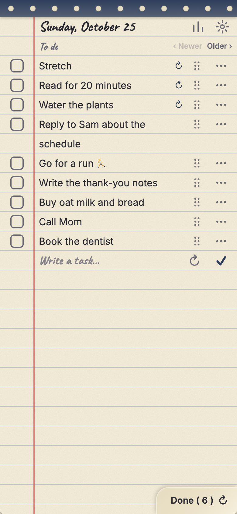
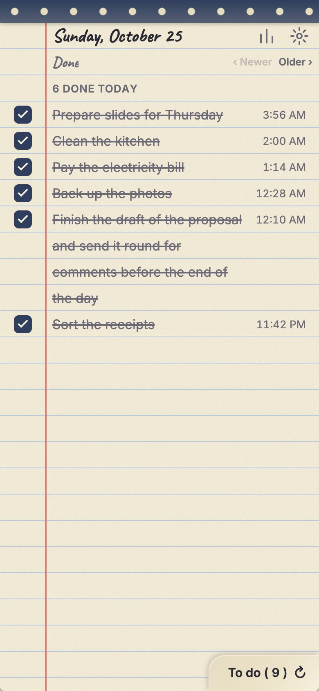
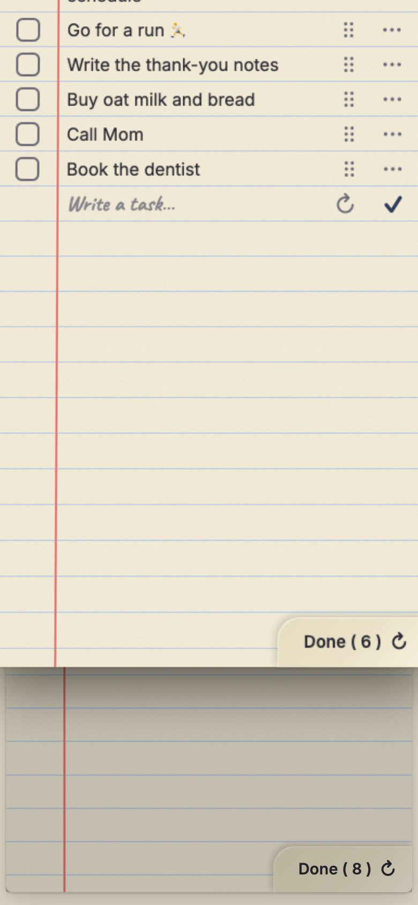
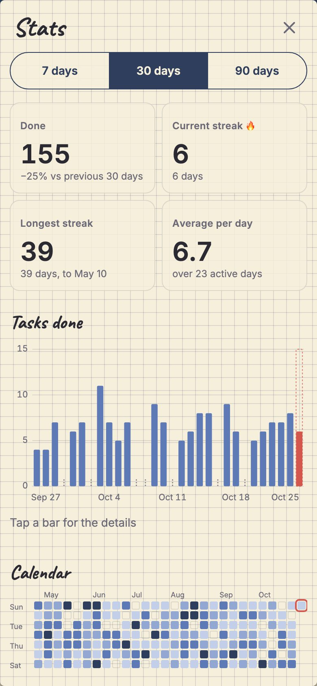

# Flipside

A mobile-first daily todo app that feels like a paper notepad.

**[Try it live → flipside-self.vercel.app](https://flipside-self.vercel.app)** (best on a phone; add it to your home screen to install it)

<p>
  
  
  
  
</p>

Each day is one page. The front shows your to-do list and the back shows what you've done: flip the page to switch sides. Pull up past the end of the list to peel the page away and see earlier days underneath. A stats sheet shows streaks, daily totals, routine completion and a year-long heatmap.

## How to use it

- **Add a task:** write on the first empty line and tap the ✓ (or press Cmd/Ctrl+Enter). Tasks can run to several lines. Tap a task's text to edit it.
- **Check it off:** tap the box. The task moves to the back of the page.
- **Flip the page:** tap the turned corner at the bottom right, swipe sideways, or press **F**. Checking off your last task turns the page for you (you can switch that off in Settings).
- **Reorder:** drag the ⋮⋮ handle, or press and hold a task. With a keyboard, press Enter on the handle, use the arrow keys, and press Enter again.
- **Routines:** switch on ↻ when adding a task, or choose "Make routine" in its ⋯ menu. It appears fresh and unchecked on every new day. Stop it from the same menu; past days keep their history.
- **Peel to earlier days:** when you are at the end of the list, pull up and the page lifts away. "Older ›" and "‹ Newer" do the same, and Back takes you home. Earlier pages are read-only, with "Copy to today" for anything unfinished.
- **Stats:** the chart icon in the page header. Tap a bar or a heatmap day for the figures, and "Open page" to go there.
- **Back up and restore:** Settings → Download backup saves a file you can keep anywhere (on a phone it opens the share sheet). "Import a backup" replaces everything on the device, after a preview, and can be undone for a few seconds. Do a backup now and then: it is the only copy besides this device.
- **Install it:** on iPhone, Share → Add to Home Screen. On Android, Install app from Chrome's menu (or the prompt). Once installed it works offline and Safari will not clear its data for being unused.

## Privacy

There are no accounts, no tracking and no analytics, and nothing you write ever leaves your device. Flipside is a static web page: your pages live in the browser's `localStorage` on your phone or computer, and backups are files you choose where to put. Clearing your browser's site data (or erasing it in Settings) deletes your tasks, so back up.

## Features

- **Today's page:** add multi-line tasks, edit in place, reorder by drag or keyboard, check off, delete with undo.
- **Routines:** mark a task as a routine and it appears, fresh and unchecked, on every new day.
- **Flip:** a 3D page turn between the to-do and done lists (button, swipe, or the **F** key). Finishing your last task turns the page for you.
- **Notepad stack:** peel up to browse earlier days. Past pages are read-only, and unfinished tasks can be copied to today.
- **Stats:** current and best streak, 30-day bar chart, weekday averages, routine completion % and a 53-week heatmap. Tap a day to open its page.
- **Backup and settings:** JSON backup and import, light/dark/system theme, auto-flip switch, storage information and a reminder when a backup is overdue.
- **Accessible:** keyboard shortcuts for every gesture, screen-reader announcements, and reduced-motion support (the flip becomes a crossfade, the peel a plain scroll).
- **Offline and installable:** a service worker caches the app; updates wait until you press "Update available · Reload" in Settings.

## Getting started

You need Node 24 LTS (see `.nvmrc`; Node 22+ works) and [pnpm](https://pnpm.io).

```bash
pnpm install
```

```bash
pnpm dev
```

Then open the URL Vite prints. The app is designed for a 375px-wide phone screen, so use your browser's device toolbar or open it on a phone on the same network (`pnpm dev --host`).

In the dev server, add `?seed=365` to the address to fill the app with a year of sample data (`?seed=1100` for three years). It replaces whatever the dev origin has stored, and the option is removed from production builds.

## Scripts

| Command              | What it does                                                                                                                 |
| -------------------- | ---------------------------------------------------------------------------------------------------------------------------- |
| `pnpm dev`           | Start the Vite dev server                                                                                                    |
| `pnpm build`         | Production build into `dist/`                                                                                                |
| `pnpm preview`       | Serve the production build (with the same security headers)                                                                  |
| `pnpm check`         | Type-check with `svelte-check` and `tsc`                                                                                     |
| `pnpm lint`          | ESLint and Prettier check                                                                                                    |
| `pnpm format`        | Format with Prettier                                                                                                         |
| `pnpm test`          | Unit and component tests (Vitest)                                                                                            |
| `pnpm test:coverage` | Tests with coverage for `src/lib`                                                                                            |
| `pnpm test:e2e`      | Playwright on iPhone 14 (WebKit) and Pixel 7 (Chromium): end-to-end, accessibility (axe), install, offline and update checks |
| `pnpm size`          | Size budget for the build (run `pnpm build` first)                                                                           |
| `pnpm lighthouse`    | Lighthouse CI on the build, mobile profile, 3 runs (run `pnpm build` first)                                                  |
| `pnpm screenshots`   | Capture the install and README images into `public/screenshots`                                                              |
| `pnpm analyze`       | Build and write `stats.html`, a map of what is in the bundle                                                                 |
| `pnpm icons`         | Regenerate PWA icons and iOS launch screens from `public/icon.svg`                                                           |
| `pnpm verify`        | `check` + `lint` + `test`                                                                                                    |

Run `pnpm verify` before committing. CI also runs the end-to-end suite, the size budget and Lighthouse.

## Tech stack

- [Svelte 5](https://svelte.dev) (runes) with strict TypeScript, built with [Vite](https://vite.dev)
- [`vite-plugin-pwa`](https://vite-pwa-org.netlify.app) for offline support and installation
- Plain CSS with custom properties; charts are hand-written SVG (no UI, CSS or chart library)
- Vitest and Testing Library for unit and component tests, Playwright (with axe) for e2e, Lighthouse CI
- Fonts: Caveat for handwriting, Inter for body text

## Project layout

```
src/
  lib/          # pure TypeScript: data model, dates, store, persistence, gestures, stats
  components/   # Svelte components: NotepadStack, DayPage, FlipCard, StatsView, charts…
  styles/       # design tokens and paper styles
  App.svelte
tests/          # test setup, helpers, Playwright specs and the screenshot script
docs/           # the QA checklist for real devices
public/         # static assets, the PWA icon source and the install screenshots
```

Logic lives in `src/lib` as pure, unit-tested functions; components stay thin. See [CLAUDE.md](CLAUDE.md) for the full design notes, data model and domain rules, [docs/qa-checklist.md](docs/qa-checklist.md) for the real-device test script, and [CHANGELOG.md](CHANGELOG.md) for what changed.

## Roadmap

Version 1.0 is feature complete. Ideas for 1.1: a calendar sheet from the date header.
